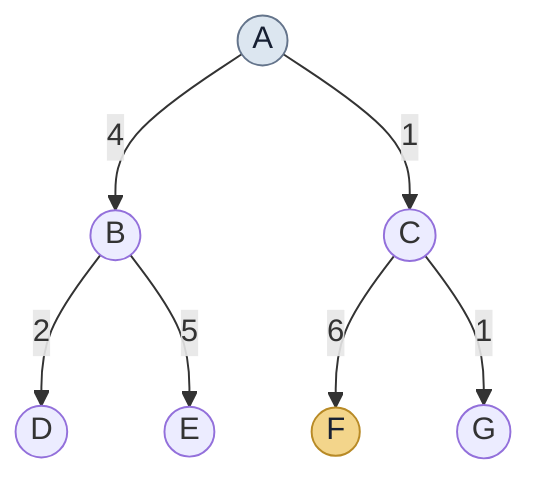

 <div align="center">

# AI Search Algorithms

### Problem Solving by Search · Uninformed Search

**A practical implementation and visualization of five fundamental blind search algorithms using Python.**

<br>


</div>

---

## 01. Project Overview

This project explores **Uninformed Search (Blind Search)** techniques through the implementation of five classical Artificial Intelligence search algorithms.

Each algorithm is implemented in Python and tested using a common directed, weighted search tree. The notebook visualizes node expansion, traversal order, and the resulting solution path.

The primary objective is to understand how different search strategies explore a search space and how their behavior differs.

## 02. Algorithms Implemented

| No. | Algorithm | Search Approach |
|:---:|---|---|
| 01 | **Breadth-First Search (BFS)** | Explores the search space level by level. |
| 02 | **Depth-First Search (DFS)** | Explores a branch deeply before backtracking. |
| 03 | **Depth-Limited Search (DLS)** | Restricts depth-first exploration to a specified limit. |
| 04 | **Iterative Deepening DFS (IDDFS)** | Repeats depth-limited searches with increasing limits. |
| 05 | **Uniform-Cost Search (UCS)** | Expands the node with the lowest cumulative path cost. |

## 03. Search Environment

All five algorithms use the same search tree.

| Parameter | Value |
|---|---|
| Initial State | `A` |
| Goal State | `F` |
| Total Nodes | `7` |
| Search Structure | Directed, weighted tree |
| Edge Weights | Positive transition costs |

### Search Tree Visualization



## 04. Graph Visualization

The notebook uses **NetworkX** and **Matplotlib** to represent the search process visually.

The visualization distinguishes between different node states:

| Visual Indicator | Description |
|---|---|
| Light Blue | Node not yet expanded |
| Light Green | Expanded node |
| Light Gold | Node belonging to the solution path |
| Orange-Red Edge | Edge belonging to the solution path |
| Number inside a node | Node expansion order |

Each algorithm generates its own graph visualization. IDDFS additionally displays the search at successive depth limits.

## 05. Experimental Results

The following results are obtained from the implemented algorithms using the same search tree and left-to-right child ordering.

| Algorithm | Expansion Order | Solution Path |
|---|---|---|
| BFS | A → B → C → D → E → F | A → C → F |
| DFS | A → B → D → E → C → F | A → C → F |
| DLS | A → B → D → E → C → F | A → C → F |
| IDDFS | Goal found at depth 2 | A → C → F |
| UCS | A → C → G → B → D → F | A → C → F |

### UCS — Path Cost Calculation

The solution path is:

```text
A → C → F

Cost = 1 + 6
     = 7
```

**Total Path Cost: 7**

> Note: This tree has a single route from A to F. UCS demonstrates cumulative-cost-based node expansion, but this example does not compare alternative paths to the same goal.

## 06. Technology Stack

| Technology | Purpose |
|---|---|
| Python | Algorithm implementation |
| Google Colab | Development and execution environment |
| NetworkX | Graph construction and processing |
| Matplotlib | Graph visualization |
| `collections.deque` | BFS queue |
| `heapq` | UCS priority queue |

## 07. Getting Started

### Run with Google Colab

1. Open [`AI_Search_Algo.ipynb`](./AI_Search_Algo.ipynb).
2. Open the notebook in Google Colab.
3. Select **Runtime → Run all**.
4. Review the algorithm outputs and visualizations.

### Run Locally

Clone the repository:

```bash
git clone https://github.com/SADMAN0433/AI-Search-Algo.git
```

Move into the project directory:

```bash
cd AI-Search-Algo
```

Install the required packages:

```bash
pip install networkx matplotlib
```

Open the notebook using Jupyter Notebook or JupyterLab.

## 08. Repository Structure

```text
AI-Search-Algo/
│
├── AI_Search_Algo.ipynb
└── README.md
```

## 09. Learning Outcomes

This implementation provides practical exposure to:

- Understanding uninformed search strategies.
- Comparing BFS and DFS traversal behavior.
- Implementing depth restrictions in DLS.
- Understanding repeated depth exploration in IDDFS.
- Working with cumulative path costs in UCS.
- Visualizing search trees and node expansion.

---

## Author

**SADMAN ISLAM ARIAN**

| Academic Information | Details |
|---|---|
| Student ID | `242031004` |
| Project | AI Search Algorithms |
| Subject Area | Artificial Intelligence |
| Assignment Topic | Problem Solving by Search — Uninformed Search |

<div align="center">

**Built as an academic implementation of fundamental AI search techniques.**

</div>
