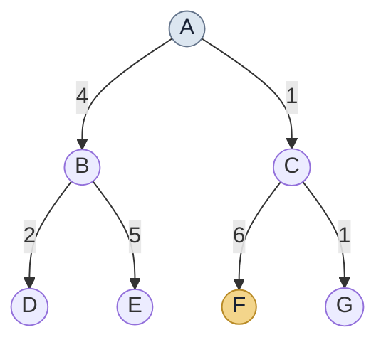

# AI Search Algorithms

<div align="center">

### Problem Solving by Search — Uninformed Search

**Exploring five fundamental search strategies through Python implementation and graph visualization.**

<p>
  
  
  
  
</p>

</div>

---

## Overview

This project implements and visualizes five **Uninformed Search (Blind Search)** algorithms using Python.

All algorithms operate on a common directed, weighted search tree, starting from node `A` and searching for the goal node `F`.

The notebook demonstrates how each algorithm explores the search space, expands nodes, and identifies a solution path.

## Algorithms

| # | Algorithm | Description |
|:---:|---|---|
| 01 | **Breadth-First Search (BFS)** | Explores nodes level by level using a queue. |
| 02 | **Depth-First Search (DFS)** | Explores one branch deeply before backtracking. |
| 03 | **Depth-Limited Search (DLS)** | Performs depth-first search within a specified depth limit. |
| 04 | **Iterative Deepening DFS (IDDFS)** | Repeatedly performs depth-limited searches with increasing limits. |
| 05 | **Uniform-Cost Search (UCS)** | Expands nodes according to their cumulative path cost. |

## Search Tree

The following tree is shared by all five algorithms.

- **Initial State:** `A`
- **Goal State:** `F`
- **Edge Labels:** Transition costs



## Visualization

Graph visualization is implemented using **NetworkX** and **Matplotlib**.

Each search algorithm generates a visual representation of its exploration process.

| Visual Element | Description |
|---|---|
| Light Blue | Node not yet expanded |
| Light Green | Expanded node |
| Light Gold | Node on the solution path |
| Orange-Red Edge | Edge on the solution path |
| Node Number | Order in which the node was expanded |

IDDFS also displays the search process at successive depth limits.

## Results

The following results are obtained using the shared search tree.

| Algorithm | Expansion Order | Solution Path |
|---|---|---|
| BFS | A → B → C → D → E → F | A → C → F |
| DFS | A → B → D → E → C → F | A → C → F |
| DLS | A → B → D → E → C → F | A → C → F |
| IDDFS | Goal found at depth 2 | A → C → F |
| UCS | A → C → G → B → D → F | A → C → F |

**Uniform-Cost Search — Total Solution Cost**

```text
A → C → F
  = 1 + 6
  = 7
```

*Note: The tree contains a single route from A to F. UCS demonstrates cost-based node expansion, but this particular example does not compare multiple alternative paths to the goal.*

## Tech Stack

- **Language:** Python
- **Environment:** Google Colab
- **Graph Handling:** NetworkX
- **Visualization:** Matplotlib
- **Data Structures:** Queue, Stack, Dictionary and Priority Queue

## Getting Started

### Run in Google Colab

1. Open `AI_Search_Algo.ipynb`.
2. Open the notebook in Google Colab.
3. Select **Runtime → Run all**.
4. Explore the traversal outputs and visualizations.

### Run Locally

Clone the repository:

```bash
git clone https://github.com/YOUR_USERNAME/AI-Search-Algo.git
```

Navigate to the project directory:

```bash
cd AI-Search-Algo
```

Install the required libraries:

```bash
pip install networkx matplotlib
```

Open the notebook using Jupyter Notebook or JupyterLab.

## Repository Structure

```text
AI-Search-Algo/
│
├── AI_Search_Algo.ipynb
└── README.md
```

## Learning Objectives

- Understand the working principles of uninformed search algorithms.
- Compare breadth-first and depth-first exploration.
- Examine how depth limits affect search performance.
- Understand iterative deepening through repeated depth-limited searches.
- Explore cumulative path costs using Uniform-Cost Search.
- Visualize node expansion and solution paths.

---

<div align="center">

**Academic Project · Artificial Intelligence**

*Problem Solving by Search — Uninformed Search / Blind Search*

</div>
